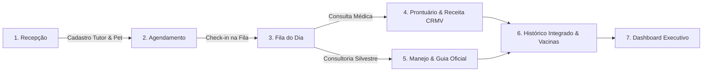

# 🌿 ZooMed Fauna & Domésticos - Sistema Clínico & Manejo Silvestre

[](https://spring.io/projects/spring-boot)
[](https://www.oracle.com/java/)
[](https://www.docker.com/)
[](https://www.mysql.com/)
[](http://localhost:8080/api/swagger-ui.html)
[](#)

> **O primeiro ecossistema veterinário integrado para atendimento médico de animais domésticos (cães e gatos) e consultoria técnica de manejo, bem-estar e recinto de fauna silvestre e pets exóticos (aves, répteis e pequenos mamíferos).**

---

## 📑 Sumário

1. [Visão Geral & Diferenciais](#-visão-geral--diferenciais)
2. [Links de Acesso Rápido](#-links-de-acesso-rápido)
3. [Perfis de Acesso & Credenciais de Demonstração](#-perfis-de-acesso--credenciais-de-demonstração)
4. [Arquitetura & Estrutura do Projeto](#-arquitetura--estrutura-do-projeto)
5. [Como Subir a Aplicação (Passo a Passo)](#-como-subir-a-aplicação-passo-a-passo)
   - [Opção 1: Via Docker Compose (Recomendado)](#opção-1-via-docker-compose-recomendado)
   - [Opção 2: Spring Boot Local + MySQL no Docker](#opção-2-spring-boot-local--mysql-no-docker)
   - [Opção 3: Execução 100% Local via Maven](#opção-3-execução-100-local-via-maven)
   - [Opção 4: Demonstração Visual Imediata (Sem Backend)](#opção-4-demonstração-visual-imediata-sem-backend)
6. [Como Acessar a Aplicação](#-como-acessar-a-aplicação)
7. [Como Trabalhar com o Aplicativo (Fluxo Operacional)](#-como-trabalhar-com-o-aplicativo-fluxo-operacional)
   - [7.1. Fluxo da Recepção / Atendimento](#71-fluxo-da-recepção--atendimento)
   - [7.2. Fluxo do Consultório Clínico (Médico Veterinário)](#72-fluxo-do-consultório-clínico-médico-veterinário)
   - [7.3. Fluxo de Manejo Silvestre (Especialista / Biólogo)](#73-fluxo-de-manejo-silvestre-especialista--biólogo)
   - [7.4. Fluxo da Administração & Métricas](#74-fluxo-da-administração--métricas)
   - [7.5. Módulo de Vacinação & Vermifugação](#75-módulo-de-vacinação--vermifugação)
8. [Regras de Negócio Fundamentais](#-regras-de-negócio-fundamentais)
9. [Comandos Rápidos & Manutenção](#-comandos-rápidos--manutenção)
10. [Solução de Problemas Comuns (Troubleshooting)](#-solução-de-problemas-comuns-troubleshooting)

---

## 🎯 Visão Geral & Diferenciais

| Desafio das Clínicas Tradicionais | Solução ZooMed Fauna & Domésticos |
| :--- | :--- |
| **Animais silvestres tratados como cães/gatos** | **Módulo técnico de recinto**, fotoperíodo, lâmpada UVB com índice calibrado, gradiente térmico e substratos atóxicos. |
| **Receitas manuais ou sem validação legal** | **Emissão automática de Receita Médica Oficial** com validação de perfil e número obrigatório do CRMV do profissional. |
| **Conflito de competências técnicas** | **Segregação de competências (RN02)**: Prontuário médico exclusivo do Veterinário; Guia de Manejo exclusivo do Especialista em Silvestres. |
| **Fila da recepção desorganizada e lenta** | **Painel da Fila do Dia em tempo real** com contadores automáticos por status (*Agendado, Aguardando, Em Atendimento, Finalizado*). |
| **Tutores perdidos nas orientações de manejo** | **Guia Oficial de Manejo Silvestre impresso**, com rotinas de condicionamento e enriquecimento ambiental em 5 dimensões. |

---

## 🌐 Links de Acesso Rápido

Com a aplicação em execução na porta padrão `8080` (context-path `/api`):

| Recurso | URL | Finalidade |
| :--- | :--- | :--- |
| 🩺 **Sistema Clínico Principal (SPA)** | [http://localhost:8080/api/](http://localhost:8080/api/) *(ou `index.html`)* | Interface operacional completa com prontuário, fila, manejo e agenda. |
| 🌿 **Showcase & Portfólio Comercial** | [http://localhost:8080/api/portfolio.html](http://localhost:8080/api/portfolio.html) | Demonstração comercial interativa, métricas de impacto e tour guiado. |
| 📖 **Documentação Swagger / OpenAPI** | [http://localhost:8080/api/swagger-ui.html](http://localhost:8080/api/swagger-ui.html) | Console interativo para explorar e testar todos os endpoints REST. |
| 📄 **Especificação OpenAPI JSON** | [http://localhost:8080/api/v3/api-docs](http://localhost:8080/api/v3/api-docs) | Raw JSON da especificação de contrato da API. |

---

## 👥 Perfis de Acesso & Credenciais de Demonstração

O sistema já é inicializado com dados de teste pré-carregados pelo `DataInitializer`. Na tela de login, você pode utilizar os **botões de Acesso Rápido (1 clique)** ou digitar as credenciais abaixo:

| Perfil | Profissional | E-mail de Teste | Senha de Teste | Competências Principais |
| :--- | :--- | :--- | :--- | :--- |
| 🩺 **Médico Veterinário** | Dr. Carlos Eduardo | `carlos.vet@zoomed.com` | `vet123` *(ou `123456`)* | Anamnese, sinais vitais, hipótese diagnóstica e **emissão de receitas com CRMV/SP 12345**. |
| 🦎 **Esp. em Silvestres / Biólogo** | Lucas Mendes | `lucas.adestrador@zoomed.com` | `adestrador123` *(ou `123456`)* | Avaliação de recinto (UVB, fotoperíodo, umidade), enriquecimento 5D e **emissão do Guia de Manejo**. |
| 📋 **Recepção / Atendente** | Ana Silva | `ana.recepcao@zoomed.com` | `atendente123` *(ou `123456`)* | Cadastro de tutores e pets, agendamentos direcionados e **controle da Fila do Dia**. |
| ⚙️ **Administradora Geral** | Mariana Oliveira | `mariana.admin@zoomed.com` | `admin123` *(ou `123456`)* | Gestão de equipe, parâmetros globais, permissão irrestrita e **dashboard de métricas**. |

> [!NOTE]
> Para testar a segregação de competências, o sistema possui validação por senha quando um usuário tenta acessar uma área restrita ou executar ações reservadas a outros perfis.

---

## 🏛️ Arquitetura & Estrutura do Projeto

O projeto adota uma arquitetura **Monolítica Spring Boot Modular**, entregando a SPA de frontend nativamente a partir dos recursos estáticos:

```text
clinica-veterinaria/
├── Dockerfile                      # Imagem Docker multi-stage com OpenJDK 17
├── docker-compose.yml              # Orquestrador de serviços (App + MySQL 8.0)
├── pom.xml                         # Dependências Maven (Spring Boot 3.3.3, JPA, MySQL, Swagger)
├── comandos.md                     # Guia rápido de comandos de terminal
├── frontend/                       # Código fonte do template da interface web
│   ├── index.html                  # Interface SPA principal do sistema
│   ├── portfolio.html              # Portfólio comercial e apresentação interativa
│   ├── css/style.css               # Folha de estilo principal com paleta bio-harmônica
│   ├── js/app.js                   # Lógica da aplicação, autenticação e regras de tela
│   └── js/services/api.js          # Cliente HTTP REST padronizado
└── src/
    ├── main/
    │   ├── java/br/com/clinicaveterinaria/
    │   │   ├── config/             # Configurações (CORS, OpenAPI, DataInitializer)
    │   │   ├── controller/         # REST Controllers (@RestController)
    │   │   ├── dto/                # Data Transfer Objects com Bean Validation
    │   │   ├── enums/              # Enumerações (CategoriaPet, StatusAgendamento, etc.)
    │   │   ├── exception/          # Tratamento global de exceções (@ControllerAdvice)
    │   │   ├── model/              # Entidades JPA (Funcionario, Tutor, Pet, Prontuario...)
    │   │   ├── repository/         # Repositórios Spring Data JPA
    │   │   └── service/            # Regras de negócio e validação
    │   └── resources/
    │       ├── application.properties        # Configurações gerais (context-path: /api)
    │       ├── application-dev.properties    # Perfil dev (H2/MySQL local)
    │       ├── application-prod.properties   # Perfil prod (MySQL Docker)
    │       └── static/                       # Cópia estática servida pelo Spring Boot
```

---

## 🚀 Como Subir a Aplicação (Passo a Passo)

### Pré-requisitos
- **Java 17 JDK** (ou superior)
- **Maven 3.9+** (ou Maven Daemon `mvnd`)
- **Docker & Docker Compose** (para execução em containers)
- Navegador Web moderno (Google Chrome, Microsoft Edge, Firefox, Safari)

---

### Opção 1: Via Docker Compose (Recomendado)

Esta é a opção ideal para rodar o ambiente completo (Aplicação + Banco de Dados MySQL 8.0) de forma isolada:

```powershell
# 1. No diretório raiz do projeto, gere o pacote .jar da aplicação:
mvn clean package -DskipTests
# (Dica: se tiver o Maven Daemon instalado, use: mvnd clean package -DskipTests)

# 2. Construa a imagem Docker e inicialize os containers em segundo plano:
docker compose up --build -d

# 3. Verifique se os containers estão saudáveis e em execução:
docker compose ps

# 4. Acompanhe os logs da inicialização do Spring Boot:
docker compose logs -f app
```

Quando o log exibir `Started ClinicaVeterinariaApplication in ... seconds`, acesse:
👉 **[http://localhost:8080/api/](http://localhost:8080/api/)**

---

### Opção 2: Spring Boot Local + MySQL no Docker

Ideal para quem está desenvolvendo e alterando código Java frequentemente, sem precisar gerar imagem Docker a cada alteração:

```powershell
# 1. Suba apenas o banco de dados MySQL via Docker:
docker compose up -d mysql

# 2. Execute a aplicação Spring Boot localmente:
mvn spring-boot:run
# (Ou via Maven Daemon: mvnd spring-boot:run)
```

A aplicação conectará automaticamente no MySQL exposto na porta `3306` do `localhost`.

---

### Opção 3: Execução 100% Local via Maven

Caso já tenha um MySQL 8.0 instalado e rodando nativamente na sua máquina:

```powershell
# 1. Certifique-se de que o banco clinica_veterinaria_db existe ou crie:
# CREATE DATABASE clinica_veterinaria_db CHARACTER SET utf8mb4 COLLATE utf8mb4_unicode_ci;

# 2. Execute os testes unitários para validar a integridade:
mvn test

# 3. Inicie o servidor:
mvn spring-boot:run
```

---

### Opção 4: Demonstração Visual Imediata (Sem Backend)

Para demonstração puramente visual dos layouts, fluxos de tela e portfólio comercial (sem necessidade de Java ou Docker instalados):

1. Navegue até a pasta `frontend/` deste projeto.
2. Dê um duplo clique ou abra no navegador:
   - 💻 **Sistema Clínico:** [`frontend/index.html`](file:///c:/Users/laura.sousa/Documents/clinica-veterinaria/frontend/index.html)
   - 🌟 **Portfólio Comercial:** [`frontend/portfolio.html`](file:///c:/Users/laura.sousa/Documents/clinica-veterinaria/frontend/portfolio.html)

---

## 💻 Como Acessar a Aplicação

Depois de iniciar a aplicação, abra seu navegador de preferência:

1. **Acesse:** `http://localhost:8080/api/` (ou `http://localhost:8080/api/index.html`).
2. **Tela de Autenticação:**
   - Escolha um dos botões de **Acesso Rápido**:
     - *Dr. Carlos* (Médico Veterinário)
     - *Lucas Mendes* (Especialista em Silvestres)
     - *Ana Silva* (Recepção)
     - *Mariana* (Administradora Geral)
   - Ou utilize o formulário informando o e-mail e a senha correspondente (consulte a tabela de credenciais).
3. **Alternar de Perfil sem Deslogar:** No menu lateral inferior esquerdo, utilize o seletor **Perfil Ativo no Sistema** para alternar rapidamente entre as visões dos profissionais.

---

## 🛠️ Como Trabalhar com o Aplicativo (Fluxo Operacional)

Abaixo está o guia detalhado das principais operações do dia a dia no sistema:



---

### 7.1. Fluxo da Recepção / Atendimento

1. **Cadastro do Tutor:**
   - No menu lateral, acesse **Tutores & Pacientes**.
   - Clique em **+ Novo Tutor** e preencha: Nome completo, CPF, Telefone (WhatsApp) e Endereço.
2. **Cadastro do Pet (Doméstico ou Silvestre):**
   - Com o tutor cadastrado, clique em **+ Novo Pet**.
   - Defina a **Categoria**: *Doméstico*, *Silvestre* ou *Exótico*.
   - Preencha: Nome, Espécie/Raça, Sexo, Idade aproximada e Peso.
   - Para animais silvestres, inclua as **Observações de Hábito/Habitat** (ex: viveiro, terrário, enriquecimento).
3. **Agendamento de Consulta ou Consultoria:**
   - Acesse **Agenda & Atendimentos** -> **+ Novo Agendamento**.
   - Selecione a Data, Horário, Tutor, Pet e o **Tipo de Serviço**:
     - *Consulta Clínica* -> Direcionada ao Médico Veterinário.
     - *Consultoria de Manejo* ou *Check-up Nutricional* -> Direcionada ao Especialista em Silvestres.
   - O agendamento aparecerá automaticamente na **Fila do Dia**.
4. **Gerenciamento da Fila do Dia:**
   - No **Dashboard / Fila**, acompanhe os pacientes do dia.
   - Ao receber o tutor na clínica, altere o status de **Agendado** para **Aguardando** e, quando chamado, para **Em Atendimento**.

---

### 7.2. Fluxo do Consultório Clínico (Médico Veterinário)

> Perfil recomendado: **Dr. Carlos Eduardo** (`carlos.vet@zoomed.com` / `vet123`)

1. **Abrir o Prontuário:**
   - Acesse **Prontuário Clínico (Vet)** no menu lateral.
   - Selecione o paciente na lista de busca ou clique em atender a partir da Fila do Dia.
2. **Registrar Anamnese e Sinais Vitais:**
   - Preencha os campos clínicos:
     - **Queixa Principal** e histórico relatado pelo tutor.
     - **Sinais Vitais:** Temperatura (°C), Frequência Cardíaca (bpm), Frequência Respiratória (mpm), Tempo de Preenchimento Capilar (TPC) e Peso (kg).
     - **Exame Físico Detalhado:** Mucosas, ausculta cardiopulmonar, palpação abdominal e linfonodos.
     - **Hipótese Diagnóstica:** Diagnóstico presuntivo ou definitivo.
     - **Conduta Terapêutica:** Plano de tratamento adotado.
3. **Emitir Receita Médica Oficial (CRMV Obrigatório):**
   - Redija a posologia e orientações de medicamentos na seção de prescrição.
   - Clique em **Salvar Prontuário & Emitir Receita Médica**.
   - O sistema gera a via oficial timbrada pronta para impressão contendo o nome completo do veterinário e o seu **CRMV ativo**.
   
> [!WARNING]
> Conforme a regra de negócio **RN02**, apenas o Médico Veterinário pode emitir receitas médicas oficiais. Perfis de recepcionista ou especialista em silvestres são bloqueados.

---

### 7.3. Fluxo de Manejo Silvestre (Especialista / Biólogo)

> Perfil recomendado: **Lucas Mendes** (`lucas.adestrador@zoomed.com` / `adestrador123`)

1. **Acessar a Consultoria de Manejo:**
   - Acesse a aba **Guia de Manejo Silvestre** no menu lateral.
   - Selecione o pet silvestre/exótico (ex: *Kiko - Papagaio Verdadeiro* ou *Tufão - Jabuti Piranga*).
2. **Avaliação Técnica do Recinto & Microclima:**
   - Preencha as especificações vitais para a saúde da espécie:
     - **Dimensões do Recinto:** Comprimento x Largura x Altura (m).
     - **Lâmpada UVB:** Espectro (ex: 5.0 ou 10.0), potência e distância segura.
     - **Fotoperíodo:** Horas de exposição à luz vs. repouso em ambiente escuro.
     - **Gradiente Térmico:** Ponto quente (°C), zona fria (°C) e taxa de umidade relativa (%).
     - **Substrato:** Tipo de material (casca de pinus atóxica, galhos naturais higienizados, etc.).
3. **Enriquecimento Ambiental 5D & Plano de Treino:**
   - Programe atividades nos eixos: *Físico*, *Sensorial*, *Cognitivo*, *Alimentar/Forrageamento* e *Social*.
   - Descreva as técnicas de condicionamento operante com reforço positivo (ex: treino de alvo/target stick).
4. **Emitir o Guia Oficial de Manejo Silvestre:**
   - Clique em **Gerar Guia Oficial de Manejo**.
   - O documento formal é gerado com orientações claras para o tutor aplicar no dia a dia.

---

### 7.4. Fluxo da Administração & Métricas

> Perfil recomendado: **Mariana Oliveira** (`mariana.admin@zoomed.com` / `admin123`)

1. **Gestão do Corpo Clínico e Equipe:**
   - Acesse **Corpo Clínico & Equipe**.
   - Cadastre novos veterinários (com validação de CRMV), especialistas em silvestres e recepcionistas.
   - Ative ou desative o acesso de profissionais conforme necessário.
2. **Monitoramento Executivo:**
   - Acompanhe no **Dashboard**: total de pacientes do dia, tempo médio de espera e taxa de ocupação da clínica.
   - Visualize a proporção de atendimentos entre espécies silvestres e domésticas.
   - Acesse o link do **Showcase & Portfólio Comercial** para apresentações corporativas.

---

### 7.5. Módulo de Vacinação & Vermifugação

1. Localizado dentro da ficha do paciente em **Tutores & Pacientes**.
2. Permite o registro histórico com:
   - Nome da vacina/medicamento (ex: V10, Antirrábica, Quádrupla Felina, vermífugos).
   - Data de aplicação e lote do fabricante.
   - **Data programada para a próxima dose / reforço anual**.
   - Veterinário responsável pela aplicação.

---

## ⚖️ Regras de Negócio Fundamentais

1. **RN01 - Vínculo Obrigatório:** Todo paciente (pet) deve obrigatoriamente estar vinculado a um tutor cadastrado com CPF válido.
2. **RN02 - Segregação Rigorosa de Competências:**
   - Prontuário médico com diagnóstico clínico e emissão de receitas é prerrogativa **exclusiva do Médico Veterinário**.
   - Consultoria de recinto e emissão do Guia de Manejo é prerrogativa **exclusiva do Especialista em Silvestres**.
   - Tentativas de acesso cruzado solicitam a senha do profissional competente.
3. **RN03 - Assinatura Legal com CRMV:** Nenhuma receita médica oficial pode ser impressa sem a inclusão explícita do número do CRMV do veterinário.
4. **RN04 - Parâmetros Mandatórios para Silvestres:** O guia de manejo exige o preenchimento de parâmetros ambientais essenciais (UVB, fotoperíodo, gradiente térmico e substrato).
5. **RN05 - Ficha Multidisciplinar Unificada:** O tutor e a equipe clínica têm acesso unificado ao histórico completo do animal, integrando evolução médica e adequação comportamental.

---

## ⚡ Comandos Rápidos & Manutenção

Para um catálogo completo de comandos operacionais, consulte o arquivo [comandos.md](file:///c:/Users/laura.sousa/Documents/clinica-veterinaria/comandos.md).

### Maven Daemon (`mvnd`) & Maven Tradicional
```powershell
# Gerar o .jar ignorando testes (build mais rápido para container):
mvn clean package -DskipTests

# Executar bateria completa de testes unitários:
mvn test

# Executar um teste específico:
mvn test -Dtest=AgendamentoServiceTest
```

### Docker & Docker Compose
```powershell
# Subir ambiente completo:
docker compose up --build -d

# Ver status dos containers:
docker compose ps

# Visualizar logs da aplicação em tempo real:
docker logs -f zoomed-app

# Reiniciar apenas o serviço da aplicação:
docker compose restart app

# Derrubar containers mantendo os dados do MySQL:
docker compose down

# Reset TOTAL (derruba containers e apaga o volume do banco):
docker compose down -v
```

---

## 🔧 Solução de Problemas Comuns (Troubleshooting)

### 1. Erro `COPY failed: file not found in build context: target/*.jar` ao rodar Docker
- **Causa:** O Dockerfile copia o `.jar` pré-compilado da pasta `target/`. Se o Maven ainda não tiver sido executado, a pasta não conterá o `.jar`.
- **Solução:** Execute antes `mvn clean package -DskipTests` e depois `docker compose up --build -d`.

### 2. Conflito de Porta `8080` ou `3306`
- **Causa:** Outro serviço (ex: outro container, Apache Tomcat ou MySQL local) já está utilizando a porta.
- **Solução:** Pare o serviço conflitante ou altere o mapeamento no `docker-compose.yml` (ex: `"8081:8080"` para a aplicação ou `"3307:3306"` para o MySQL).

### 3. A aplicação inicia mas não conecta no MySQL no Docker
- **Causa:** O container do MySQL ainda não concluiu a rotina de inicialização.
- **Solução:** O `docker-compose.yml` já possui `healthcheck` configurado. Caso suba manualmente, aguarde alguns segundos até que o banco responda com `healthy` antes de subir a aplicação.

### 4. A página não carrega CSS ou JS ao acessar
- **Causa:** O Spring Boot está configurado com `server.servlet.context-path=/api`.
- **Solução:** Acesse sempre com o prefixo `/api/`: [http://localhost:8080/api/](http://localhost:8080/api/) ou abra diretamente pelo arquivo [`frontend/index.html`](file:///c:/Users/laura.sousa/Documents/clinica-veterinaria/frontend/index.html).

---

## 👩‍💻 Equipe & Desenvolvimento

Desenvolvido para excelência clínica em medicina veterinária de animais de companhia e conservação de fauna silvestre.

* **ZooMed Fauna & Domésticos** © 2026 - Todos os direitos reservados.
