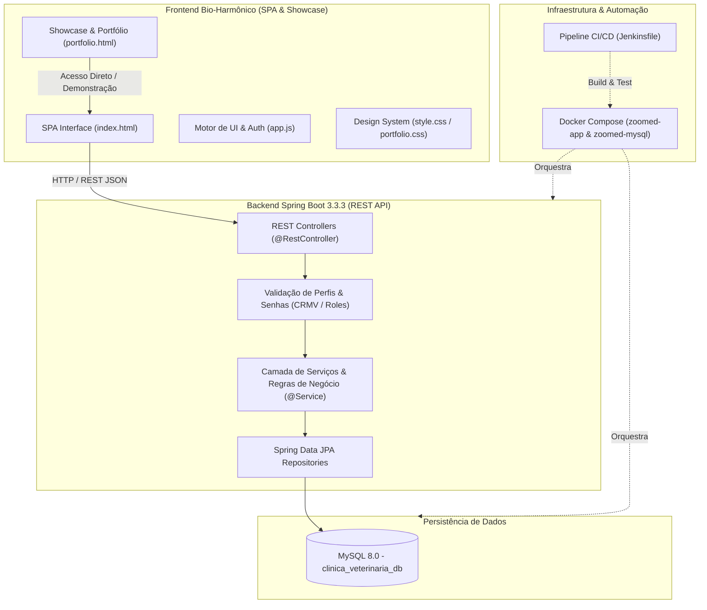

# 🌿 ZooMed Fauna & Domésticos - Sistema Clínico & Manejo Silvestre

[](https://spring.io/projects/spring-boot)
[](https://www.oracle.com/java/)
[](https://www.docker.com/)
[](https://www.mysql.com/)
[](https://www.jenkins.io/)
[](#)

> **O primeiro ecossistema veterinário integrado para atendimento médico de animais domésticos (cães e gatos) e consultoria de manejo e bem-estar de fauna silvestre e pets exóticos (aves, répteis e pequenos mamíferos).**

---

## 🌟 Acesse o Portfólio & Demonstração Interativa

- 🚀 **[Showcase & Portfólio Comercial do Sistema](file:///c:/Users/laura.sousa/Documents/clinica-veterinaria/frontend/portfolio.html)**: Apresentação visual de alto impacto com tour interativo das telas, simulador de perfis por profissional, calculadora de impacto e métricas.
- 💻 **[Sistema Clínico Completo (Live Demo)](file:///c:/Users/laura.sousa/Documents/clinica-veterinaria/frontend/index.html)**: Interface clínica com prontuário veterinário, fila do dia, guia de manejo silvestre e emissão de receita com CRMV.

---

## 🎯 Proposta de Valor & Diferenciais

| Desafio das Clínicas Tradicionais | Solução Inovadora ZooMed Fauna & Domésticos |
| :--- | :--- |
| **Animais silvestres tratados como cães/gatos** | **Módulo exclusivo com parâmetros de recinto**, lâmpada UVB, fotoperíodo, umidade e gradiente térmico. |
| **Receitas manuais ou sem validação legal** | **Emissão automática de Receita Médica Oficial** com nome e número do CRMV obrigatório do veterinário. |
| **Conflito de competências profissionais** | **Segregação rigorosa (Regra RN02)**: Prontuário médico exclusivo do Veterinário e Guia de Manejo com o Especialista em Silvestres. |
| **Fila da recepção desorganizada e lenta** | **Painel em tempo real da Fila do Dia** com contadores automáticos por status (*Agendado, Aguardando, Em Atendimento, Finalizado*). |
| **Tutores perdidos nas orientações de manejo** | **Guia Oficial de Manejo Silvestre impresso**, contendo diretrizes claras de recinto, dieta e enriquecimento 5D. |

---

## 🏛️ Arquitetura do Sistema



---

## 👥 Perfis de Acesso & Credenciais para Testes

O sistema conta com usuários de demonstração já pré-carregados para avaliação imediata:

| Perfil | Profissional | Credencial / E-mail | Senha de Teste | Competências Principais |
| :--- | :--- | :--- | :--- | :--- |
| **Médico Veterinário** | Dr. Carlos Eduardo | `carlos.vet@zoomed.com` | `vet123` | Exame clínico, sinais vitais, hipótese diagnóstica e **emissão de receitas com CRMV/SP 12345**. |
| **Esp. em Silvestres / Biólogo** | Lucas Mendes | `lucas.adestrador@zoomed.com` | `adestrador123` | Análise de recinto (UVB, fotoperíodo), enriquecimento ambiental e **emissão do Guia de Manejo Silvestre**. |
| **Recepção / Atendente** | Ana Silva | `ana.recepcao@zoomed.com` | `atendente123` | Cadastro de tutores e pets, agendamentos direcionados e **controle da Fila do Dia**. |
| **Administradora Geral** | Mariana Oliveira | `mariana.admin@zoomed.com` | `admin123` | Gestão da equipe, permissões, parâmetros globais e **dashboard executivo de métricas**. |

---

## 📋 Módulos Principais

### 1. 🩺 Consultório Clínico & Prontuário Médico
- Registro completo de sinais vitais: Temperatura (°C), Frequência Cardíaca (bpm), Frequência Respiratória (mpm), Tempo de Preenchimento Capilar (TPC) e Peso (kg).
- Anamnese estruturada e hipóteses diagnósticas.
- Emissão de receituário médico com carimbo digital e conformidade com as diretrizes do CRMV.

### 2. 🦎 Manejo Silvestre & Consultoria de Recinto
- Registro minucioso do habitat do animal: dimensões (C x L x A), tipo de substrato e ventilação.
- Parâmetros ambientais vitais: Lâmpadas UVB com espectro calibrado, fotoperíodo (horas de luz/dia) e gradiente térmico (ponto quente e zona fria).
- Planejamento de enriquecimento ambiental em 5 dimensões (físico, sensorial, cognitivo, alimentar e social).
- Emissão do Guia Oficial de Manejo impresso para acompanhamento do tutor.

### 3. 📋 Recepção & Triagem Inteligente
- Fila de espera dinâmica com atualização instantânea de status.
- Busca unificada e cadastro rápido de múltiplos pets por tutor.
- Detecção automática de espécies com temas visuais dedicados.

### 4. 💉 Carteira de Vacinação & Profilaxia
- Histórico imunológico vitalício de vacinas e vermífugos.
- Alertas e datas programadas para próximas doses de reforço.

### 5. 📊 Painel Executivo & Business Intelligence
- Total de pacientes no dia e tempo médio de espera.
- Gráficos de distribuição por espécies (Aves, Répteis, Cães, Gatos e Pequenos Mamíferos).

---

## 🚀 Como Executar o Projeto

### Pré-requisitos
- **Java 17** (JDK)
- **Maven 3.9+** (ou Maven Wrapper)
- **Docker & Docker Compose** (opcional, para execução conteinerizada)
- Navegador Web moderno (Chrome, Edge, Firefox)

### Opção 1: Via Docker Compose (Recomendado)
```bash
# Subir aplicação Spring Boot e banco MySQL 8 com um comando:
docker-compose up --build -d

# Visualizar logs da aplicação:
docker-compose logs -f app
```
Acesse a aplicação em: `http://localhost:8080/index.html` ou `http://localhost:8080/portfolio.html`.

### Opção 2: Localmente via Maven
```bash
# Compilar e executar os testes:
mvn clean test

# Iniciar o servidor Spring Boot:
mvn spring-boot:run
```

### Opção 3: Demonstração Visual Imediata (Sem Backend)
Para uma demonstração puramente visual dos templates, basta abrir diretamente no navegador:
- [Abrir Portfólio de Apresentação](file:///c:/Users/laura.sousa/Documents/clinica-veterinaria/frontend/portfolio.html)
- [Abrir Interface do Sistema](file:///c:/Users/laura.sousa/Documents/clinica-veterinaria/frontend/index.html)

---

## 🛠️ Tecnologias Utilizadas

- **Backend:** Java 17, Spring Boot 3.3.3, Spring Data JPA, Spring Validation, OpenAPI 3 / Swagger.
- **Banco de Dados:** MySQL 8.0 com volumes persistentes.
- **Frontend:** HTML5 Semântico, CSS3 Moderno (Variáveis HSL/Hex, Glassmorphism, Flexbox, Grid), JavaScript Vanilla Modular.
- **DevOps:** Docker, Docker Compose, Jenkins Pipeline CI/CD declarativa.
- **Tipografia & Ícones:** Google Fonts (*Outfit* & *Plus Jakarta Sans*), Font Awesome 6 Pro SVGs.

---


